<div align="center">

<picture>
  <source media="(prefers-color-scheme: dark)" srcset=".github/assets/banner-dark.svg">
  
</picture>

**Device contacts and the SMS composer for PAM Native apps.**<br>
Paged contact reads, the system new-contact form and a prefilled SMS composer, from PHP.

[](https://packagist.org/packages/pushinbr/pam-native-contacts)
[](https://github.com/push-in/pam-native-contacts/releases/latest)

[](https://github.com/push-in/pam-native-contacts/actions/workflows/ci.yml)
[](LICENSE)

[Install](#install) · [Quick example](#quick-example) · [Platforms](#platform-support) · [Permissions](#requirements) · [Docs](#docs) · [Issues](https://github.com/push-in/pam-native-contacts/issues)

</div>

<a id="install"></a>
## <picture></picture> Install

Inside a PAM Native project, add only this capability:

```sh
pam composer require pushinbr/pam-native-contacts
pam doctor --fix
```

Requires `pushinbr/pam-native` 1.46 or newer (plugin hooks `WatchChannel` and `ActivityResultHost`). The plugin is discovered from Composer; no manual registration is needed. New to PAM? Create a project with `pam init my-app --template native` (see the [PAM Native overview](https://push-in.github.io/pam-docs/native/overview/)).

<a id="quick-example"></a>
## <picture></picture> Quick example

```php
use Pam\Native\Contacts\Contact;
use Pam\Native\Contacts\Contacts;
use Pam\Native\Contacts\Sms;

Contacts::all(static function (array $contacts): void {
    // list<Contact>: displayName, phoneNumbers, emailAddresses
});

Contacts::openNewContactForm(static function (bool $saved): void {
    // true when the user saved a contact
});

Sms::compose(['+5511999999999'], 'Hi!', static function (): void {});
```

`Contacts::all()` reads the address book in pages of 250 and calls back once with every `Contact` (`id`, `displayName`, `givenName`, `familyName`, `phoneNumbers`, `emailAddresses`). `Sms::compose()` opens the platform composer; it never sends a message automatically.

<a id="platform-support"></a>
## <picture></picture> Platform support

| Platform | Support | Notes |
| --- | --- | --- |
| Android | API 26+ | Modules `contacts` and `sms`; no extra dependencies |
| iOS | 15.0+ | Contacts, ContactsUI, MessageUI |
| PAM Native | 1.46.0 to < 2.0.0 | From `pam-native.plugin.json`; PHP 8.5+ |

<a id="requirements"></a>
## <picture></picture> Permissions and requirements

| Platform | Declared by the plugin |
| --- | --- |
| Android | `android.permission.READ_CONTACTS` |
| iOS | `NSContactsUsageDescription` ("Find people you know.") |

The new-contact form needs no contacts permission (Android `ACTION_INSERT`, iOS `CNContactViewController`).

<a id="migrating"></a>
## <picture></picture> Migrating from the core

Moved out of the PAM Native core in 1.46: the core keeps only the base every app needs, and this feature ships as a plugin. The native module name and its wire payloads did not change.

The 1.46 core keeps the old class names (`Pam\Native\System\...` and the top-level value types) as deprecated aliases of this plugin's classes; they are removed in 1.47. Replace the imports with the `Pam\Native\Contacts\...` names above.

<a id="tests"></a>
## <picture></picture> Tests

```bash
php tests/run.php            # after composer install
PAM_NATIVE_SRC=../pam-native/packages/native/src php tests/run.php
```

<a id="docs"></a>
## <picture></picture> Docs

- [PAM Native overview](https://push-in.github.io/pam-docs/native/overview/)
- [PAM introduction](https://push-in.github.io/pam-docs/introduction/)
- [Changelog](CHANGELOG.md)
- [Report an issue](https://github.com/push-in/pam-native-contacts/issues)

<a id="pam-ecosystem"></a>
## <picture></picture> Part of the PAM ecosystem

PAM runs PHP natively on servers, desktops and phones. This repository is one piece of it.

| [**PAM**](https://github.com/push-in/pam) | [**PAM Desktop**](https://github.com/push-in/pam-desktop) | [**PAM Native**](https://github.com/push-in/pam-native) | [**Ecosystem**](https://github.com/push-in/pam#ecosystem) |
| --- | --- | --- | --- |
| the runtime and CLI | native desktop apps in PHP | native Android and iOS apps in PHP | every official package and plugin |

<sub>Docs: [push-in.github.io/pam-docs](https://push-in.github.io/pam-docs/introduction/) · [Issues](https://github.com/push-in/pam-native-contacts/issues)</sub>

<p align="center"><sub><a href="LICENSE">Apache License 2.0</a> · Made in Brazil by Pushin</sub></p>
